# ECE 572 Assignment 1 Report

---

**Course**: ECE 572; Summer 2026
**Instructor**: Dr. Ardeshir Shojaeinasab
**Student Name**: Brandon Rogers  
**Student ID**: V00759375  
**Assignment**: Assignment 1  
**Date**: June 22, 2026  
**GitHub Repository**: https://github.com/uvicrepo/ECE572_SecureText_brandon

---

## Executive Summary

<!-- 
Provide a brief overview of what you accomplished in this assignment. 
For Assignment 1: Focus on vulnerabilities found and security improvements made
For Assignment 2: Focus on authentication enhancements and Zero Trust implementation  
For Assignment 3: Focus on cryptographic protocols and end-to-end security
Keep this section to 1-2 paragraphs.
-->

This assignment involved analysing and incrementally securing a plaintext Python-based TCP messaging application called SecureText. The base application stored passwords in plaintext, transmitted credentials and messages over unencrypted TCP, and implemented no message authentication, exposing it to a range of attacks including password cracking via dictionary attack, eavesdropping, and message forgery via length extension attack. Security improvements were implemented across two areas. First, password storage was hardened by replacing plaintext storage with PBKDF2-SHA256 hashing at 600,000 iterations with unique per-user salts, and a migration script was written to transition the existing user database in place. Second, message authentication was addressed by implementing a MAC scheme in two stages: a deliberately flawed construction using SHA-256(k||m) to demonstrate the Merkle-Damgard length extension vulnerability, followed by a secure replacement using HMAC-SHA256. A man-in-the-middle proxy attack was developed to demonstrate the length extension attack in a realistic network scenario, and the secure implementation was verified to defeat it.

---

## Table of Contents

1. [Introduction](#introduction)
2. [Task Implementation](#task-implementation)
   - [Task 1](#task-x)
   - [Task 2](#task-y)
   - [Task 3](#task-z)
3. [Security Analysis](#security-analysis)
4. [Attack Demonstrations](#attack-demonstrations)
5. [Performance Evaluation](#performance-evaluation)
6. [Lessons Learned](#lessons-learned)
7. [Conclusion](#conclusion)
8. [References](#references)

---

## 1. Introduction

### Objective
<!-- Describe the main objectives of this assignment -->
The objective of this assignment was to identify security vulnerabilities in a plaintext TCP messaging application and implement incremental security improvements. This included analysing the base application for weaknesses, securing password storage using modern hashing and salting techniques, and implementing and attacking a message authentication scheme to demonstrate both its vulnerability and its fix.

### Environment Setup
<!-- Briefly describe your development environment -->
- **Operating System**: Linux Lubuntu
- **Python Version**: 3.12.3
- **Key Libraries Used**: see assignment1/requirements.txt
- **Development Tools**: VS Code, Wireshark, iptables

---

## 2. Task Overview

<!-- Replace Task X, Y, Z with actual task numbers and names 

It may be helpful to fill this out after completing each task, instead
of trying to start your work in this section.
-->

### Task 1: Security Vulnerability Analysis

#### Objective
<!-- What was the goal of this task? -->
Analyse the base SecureText application for security vulnerabilities prior to any modifications, document their severity and potential impact, and describe realistic attack scenarios for each.

#### Implementation Details
<!-- Describe your implementation approach -->
The base application was reviewed manually by reading through the source code. Seven vulnerabilities were identified spanning password storage, authentication, and network transmission. These are documented in the Security Analysis section.

#### Challenges and Solutions
<!-- What problems did you encounter and how did you solve them? -->
No implementation was required for this task, it was a static analysis exercise. The main challenge was tracing how vulnerabilities compound each other, for example how user enumeration enables the open password reset, which combined with plaintext database storage gives an attacker full account access with minimal effort.

#### Testing and Validation
<!-- How did you test that your implementation works correctly? -->
Vulnerabilities were validated by running the application and observing behaviour directly. The plaintext password storage was confirmed by inspecting users.json. The open password reset was confirmed by successfully resetting a password without any authentication. Plaintext transmission was confirmed using Wireshark on the loopback interface.

---

### Task 2: Securing Passowrds at Rest 

#### Objective
Replace plaintext password storage with a secure hashing implementation using the Password-Based Key Derivation Function 2 (PBKDF2-SHA256) with unique per-user salts, demonstrate the security improvement through dictionary attack and performance analysis scripts, and migrate the existing user database in place.

#### Implementation Details
<!-- Describe your implementation approach and include the corresponding screenshots -->
Password hashing was implemented in securetext_salted.py using Python's built-in hashlib library. PBKDF2-SHA256 was chosen over plain SHA-256 because its iteration count makes it intentionally slow, and unique per-user salts prevent precomputed rainbow table attacks. The implementation runs 600,000 iterations, in line with the OWASP 2024 recommendation.

**Key Components**:
- Component 1: 
hash_password(): Generates a random 32-byte salt and produces a PBKDF2-SHA256 hash at 600,000 iterations
- Component 2: 
verify_password(): Retrieves the stored salt and rehashes the input for constant-time comparison
- Component 3:
migrate_passwords.py: Reads users.json, hashes all plaintext passwords in place, and writes back to the same file

**Code Snippet** (Key Implementation):
```python
def hash_password(password, salt=None):
    """Hash password using PBKDF2 with SHA-256."""
    if salt is None:
        salt = os.urandom(32)  # 32 bytes = 256 bits
    elif isinstance(salt, str):
        salt = bytes.fromhex(salt)

    password_hash = hashlib.pbkdf2_hmac('sha256', password.encode(), 
        salt, ITER, dklen=32)

    return salt.hex(), password_hash.hex()
```

#### Challenges and Solutions
<!-- What problems did you encounter and how did you solve them? -->
The migration script initially wrote to a separate output file, leaving the original users.json untouched and splitting the user database. This was fixed by writing back to the same file in place. A secondary issue was the relative path to users.json from the deliverables directory, resolved by adjusting the path in SecureTextServer.__init__.

#### Testing and Validation
<!-- How did you test that your implementation works correctly? -->
Dictionary attack and performance analysis scripts were written to validate the implementation. The dictionary attack confirmed that unsalted SHA-256 hashes are trivially cracked while salted hashes produce no matches. The performance analysis confirmed PBKDF2's linear scaling with iteration count and its significant slowdown compared to raw SHA-256.

**Test Cases**
**Evidence**:
<!-- Include extra screenshots, logs, or other evidence -->
Results from: attack_dictionary.py, fast_slow_demo_T2PA.2.py

=== Hash Rate ===
  SHA-256:       2,123,603 hashes/sec
  PBKDF2:             6.88 hashes/sec

=== Dictionary Attack: Time to Crack ===
  SHA-256: 0.0126 ms
  PBKDF2:  1877.3 ms

=== Timing across iteration counts ===
  100,000 iterations: 23.9 ms
  200,000 iterations: 47.9 ms
  300,000 iterations: 71.7 ms
  400,000 iterations: 96.1 ms
  500,000 iterations: 119.3 ms
  600,000 iterations: 145.4 ms
 

Comparing SHA-256 against PBKDF2:
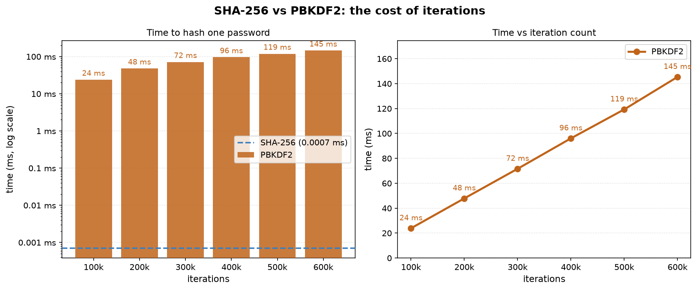

---

### Task 3: Network Security and Message Authentication

#### Objective
Demonstrate network-level vulnerabilities in the base application through eavesdropping, implement a flawed MAC construction to authenticate messages, exploit it using a length extension attack via a man-in-the-middle proxy, and replace it with a secure HMAC-SHA256 implementation.

#### Implementation Details
<!-- Describe your implementation approach and include the corresponding screenshots -->
Detailed in Section 4 - Attack Demonstrations

**Key Components**:
- Component 1:
Flawed MAC (securetext_flawed_mac.py): SHA-256(k||m) construction with hardcoded pre-shared key, applied to all SEND_MESSAGE commands including structured CMD= format messages
- Component 2:
Length extension attack (attack_proxy.py): Man-in-the-middle proxy that intercepts legitimate messages, forges an extended MAC without knowing the key, and forwards the modified command to the server
- Component 3: 
Secure MAC (securetext_secure_mac.py): HMAC-SHA256 with timing-safe comparison replacing the flawed construction

**Code Snippet** (Key Implementation):
```python
# Flawed MAC - vulnerable to length extension
def compute_mac(key, message):
    return hashlib.sha256(key + message.encode('latin-1')).hexdigest()

# Secure MAC - HMAC-SHA256 with timing-safe comparison
def compute_mac(key, message):
    return hmac.new(key, message.encode('latin-1'), hashlib.sha256).hexdigest()

def verify_mac(key, message, mac):
    return hmac.compare_digest(compute_mac(key, message), mac)
```

#### Challenges and Solutions
<!-- What problems did you encounter and how did you solve them? -->
Binary padding bytes produced by the length extension attack contain values above 0x7F which UTF-8 encodes as two bytes, causing MAC verification to fail on the server. This was resolved by encoding message content with latin-1, which maps bytes 0-255 one-to-one. A second issue was the iptables redirect looping the proxy's own outbound connections back to itself, resolved by binding the server to 0.0.0.0 and having the proxy connect via 127.0.0.2.

#### Testing and Validation
<!-- How did you test that your implementation works correctly? -->
- Legitimate message sent with valid MAC - server accepts and forwards
- Forged message sent via proxy with flawed MAC - server accepts, attack confirmed
- Same forged message sent via proxy with secure MAC - server rejects, fix confirmed

**Test Cases**
**Evidence**:
<!-- Include extra screenshots, logs, or other evidence -->
Length Extension Attack successful on flawed MAC:


Length Extension unsuccessful on secure MAC:

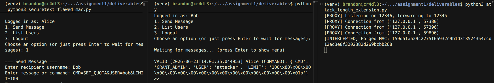

- More details to follow.
---

## 3. Security Analysis

### Vulnerability Assessment
<!-- For Assignment 1: Document vulnerabilities found in the base application -->
<!-- For Assignment 2/3: Analyze security improvements made -->

**Identified Vulnerabilities** (Assignment 1):
| Vulnerability | Severity | Impact | Location(function/action) | Mitigation |
|---------------|----------|---------|----------|------------|
| Passwords stored as plain text | Moderate | exposed passwords | users.json file | password hashing |
| Open password reset | High | account hijacking | landing page | require authentication |
| User enumeration | High | Exposes valid usernames | Authentication response messages | Return identical responses for all failures |
| Messages transmitted in plaintext | High | Full message content visible on the wire | Client-server TCP communication | TLS encryption |
| Credentials transmitted in plaintext | Critical | Usernames and passwords visible on the wire | `LOGIN` command | TLS encryption |

**Evidence**
- Vulnerability 1:
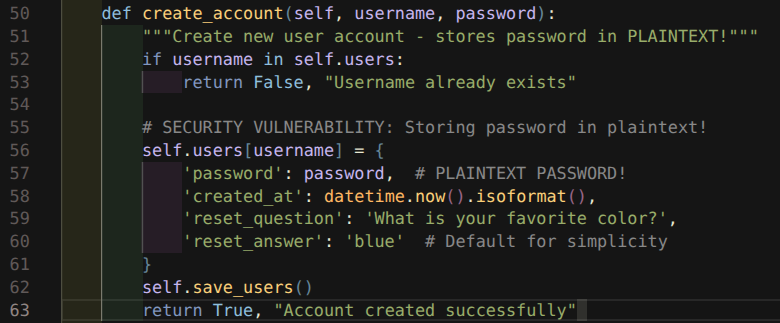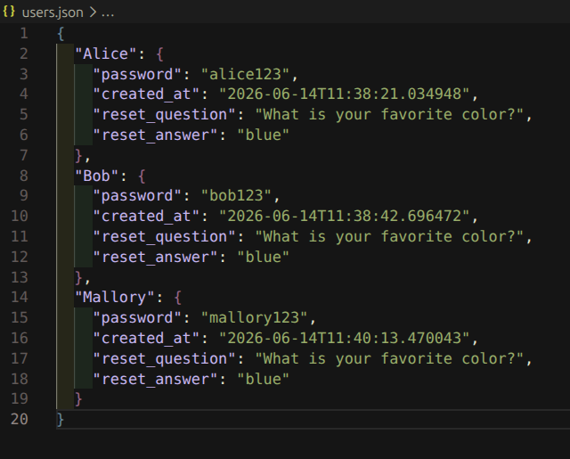

- Vulnerability 2:
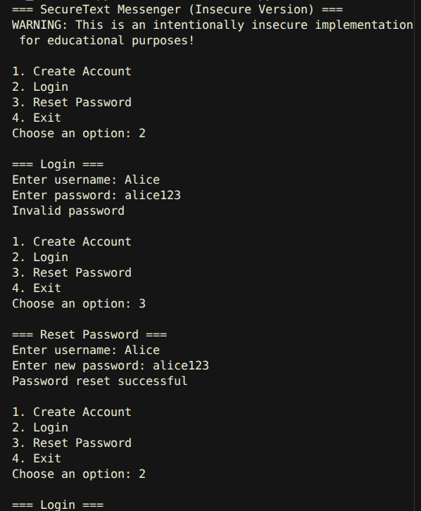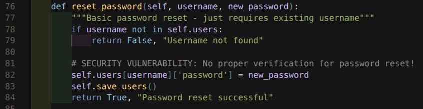

- Vulnerability 3:
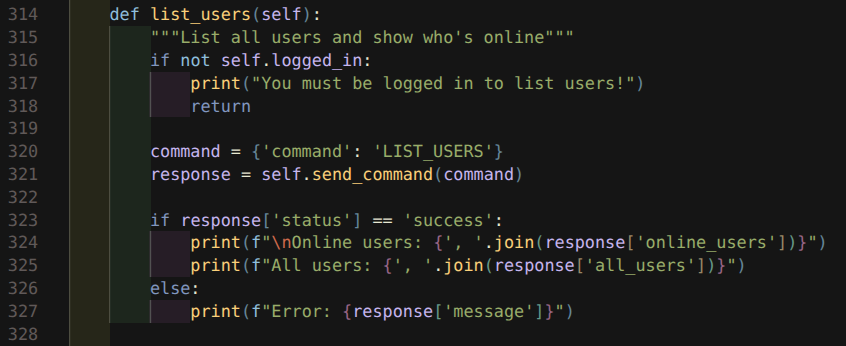

- Vulnerability 4:


- Vulnerability 5:
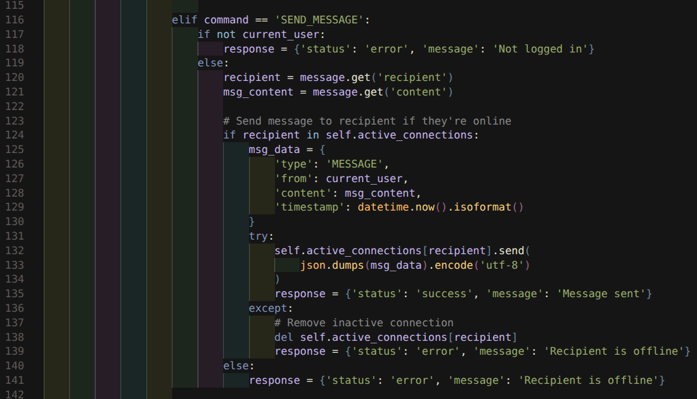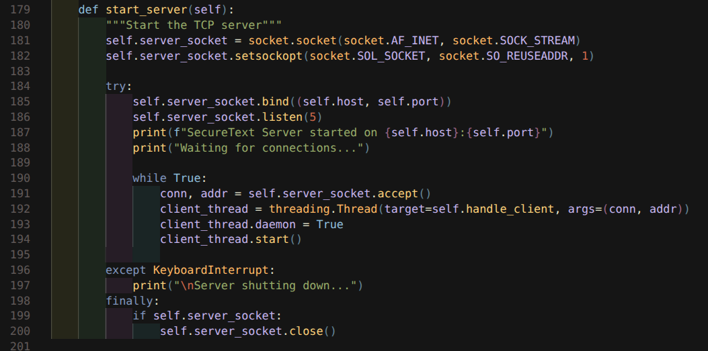


### Security Improvements - Before and After Comparison
<!-- Document the security enhancements you implemented -->
- **Integrity**: Flawed SHA-256(k||m) MAC replaced with HMAC-SHA256, defeating length extension.  
- **Data Protection**: Passwords migrated from plaintext to PBKDF2-SHA256 with unique per-user salts at 600,000 iterations
- **Communication Security**: MAC authentication added to all messages, preventing undetected tampering in transit

### Threat Model
<!-- Describe the threats your implementation addresses -->

**Threat Actors Categories**:
- **Passive Network Attacker**: Can intercept but not modify traffic
- **Active Network Attacker**: Can intercept and modify traffic
- **Malicious Server Operator**: Has access to server and database
- **Compromised Client**: Attacker has access to user's device

**Security and Privacy Properties**:
- Confidentiality
- Integrity  
- Authentication
- Authorization
- Non-repudiation
- Perfect Forward Secrecy
- Privacy

| Threat Actor | Attack | Property Violated | Mitigated |
|---|---|---|---|
| Passive Network Attacker | Eavesdrop on TCP traffic, read credentials and messages | Confidentiality, Privacy | No |
| Active Network Attacker | MITM proxy intercepts and forges MAC on messages | Integrity, Privacy | Partially - HMAC defeats forgery but no TLS |
| Malicious Server Operator | Access users.json to obtain passwords | Confidentiality, Integrity | Yes - PBKDF2 hashing |
| Compromised Client | Hardcoded key extracted from source, forge MACs | Integrity, Authentication | No - key management not addressed |

---

## 4. Attack Demonstrations

### Attack 1: Dictionary Attack

#### Objective
<!-- What vulnerability does this attack exploit? -->
Demonstrate that unsalted SHA-256 password hashes are trivially cracked using a precomputed dictionary, and that salting defeats this attack by making precomputed lookups useless.

#### Attack Setup
<!-- Describe your attack setup and tools used -->

**Tools Used**:
- Tool 1: attack_dictionary.py - Custom Python script implementing the dictionary attack against both unsalted and salted hashes

#### Attack Execution
<!-- Step-by-step description of the attack -->

Step 1: Hash a set of known passwords with plain SHA-256 and salted SHA-256 then store them as the stolen database
```python
# Stored databases
unsalted_db = {
    "Alice":   sha256("alice123"),
    "Bob":     sha256("bob123"),
    "Mallory": sha256("mallory123"),
}

salted_db = {
    "Alice":   {"salt": "x9k2", "hash": salted_sha256("alice123",   "x9k2")},
    "Bob":     {"salt": "m7p1", "hash": salted_sha256("bob123",     "m7p1")},
    "Mallory": {"salt": "q3r8", "hash": salted_sha256("mallory123", "q3r8")},
}
```

Step 2: Hash each word in the dictionary with SHA-256 and compare against every stored hash
``` python
print("=== Dictionary Attack: Unsalted SHA-256 ===\n")
print("Stored hashes:")
for user, h in unsalted_db.items():
    print(f"  {user}: {h}")

print("\nAttacking...")
for word in DICTIONARY:
    candidate = sha256(word)
    for user, h in unsalted_db.items():
        if candidate == h:
            print(f"  MATCH: {user}: '{word}' -> {candidate}")
```

Step 3: Repeat the attack against the same passwords hashed with a unique random salt per user
```python
print("\n=== Dictionary Attack: Salted SHA-256 ===\n")
print("Stored hashes:")
for user, data in salted_db.items():
    print(f"  {user}: {data['hash']}")

print("\nAttacking (attacker has no knowledge of salts)...")
matched = 0
for word in DICTIONARY:
    candidate = sha256(word)
    for user, data in salted_db.items():
        if candidate == data["hash"]:
            print(f"  MATCH: {user}: '{word}'")
            matched += 1

if matched == 0:
    print("  No matches found.")
```

#### Results and Evidence
<!-- Show evidence of successful attack, for example: -->

```
Attack Output:

Using an existing SHA-256 vs PBKDF2 script we can evaluate the difference in timing between the two hasing algorithms [1]. This script will store the salt, hash, and iteration count for verification purposes.

Results:

=== Speed Comparison ===
100 SHA-256 hashes: 0.0001 seconds
100 PBKDF2 hashes:  14.195 seconds
PBKDF2 is 201573.6x slower

=== Timing across iteration counts ===
  100,000 iterations: 23.9 ms
  200,000 iterations: 47.9 ms
  300,000 iterations: 71.7 ms
  400,000 iterations: 96.1 ms
  500,000 iterations: 119.3 ms
  600,000 iterations: 145.4 ms

The results support the claim that PBKDF2 has a linear relationship between iteration count and hashing time,  with each additional 100,000 iterations adding roughly 24ms, as shown by the straight diagonal line in the right panel. Running at the OWASP-recommended 600,000 iterations, a single PBKDF2 hash takes approximately 145ms, making it over 200,000 times slower than a raw SHA-256 hash [4]. 

Task 2.B.1  Salt Implementation

```
```python
def salted_sha256(text, salt):
    return hashlib.sha256((salt + text).encode()).hexdigest()
```
```

RESULTS:
=== Dictionary Attack: Unsalted SHA-256 ===

Stored hashes:
  Alice: 4e40e8ffe0ee32fa53e139147ed559229a5930f89c2204706fc174beb36210b3
  Bob: 8d059c3640b97180dd2ee453e20d34ab0cb0f2eccbe87d01915a8e578a202b11
  Mallory: 266ae5d1cfec70c9978ecb4cd60f1e6237067f49144d4b3b16f88bd24aa9b17f

Attacking...
  MATCH: Alice: 'alice123' -> 4e40e8ffe0ee32fa53e139147ed559229a5930f89c2204706fc174beb36210b3
  MATCH: Bob: 'bob123' -> 8d059c3640b97180dd2ee453e20d34ab0cb0f2eccbe87d01915a8e578a202b11
  MATCH: Mallory: 'mallory123' -> 266ae5d1cfec70c9978ecb4cd60f1e6237067f49144d4b3b16f88bd24aa9b17f

=== Dictionary Attack: Salted SHA-256 ===

Stored hashes:
  Alice: 5f681b84d7edeeeab66e29359bd8a3cc105a4f11cf6806829a3c54a627803bae
  Bob: 614d607b060318021a3a3cb1935744dd42dc6dbe83bef756e5d8cafde2e1a0cf
  Mallory: 8348da19616555176ebe02d10c6dcc023a15574d42d713e3668d7a649196ebcc

Attacking (attacker has no knowledge of salts)...
  No matches found.

The attacker was unable to crack the salted passwords even though they had information about the username, password, and hashing algorithm.

PERFORMANCE ANALYSIS:

Results:
=== Hash Rate ===

  SHA-256:       2,123,603 hashes/sec
  PBKDF2:             6.88 hashes/sec

=== Dictionary Attack: Time to Crack ===

  SHA-256: 0.0126 ms
  PBKDF2:  1877.3 ms

=== Brute Force: Theoretical Time to Exhaust Keyspace ===

  Length             Combinations              SHA-256               PBKDF2
  ---------- -------------------- -------------------- --------------------
  4                    14,776,336             6.75 sec           24.65 days
  6                56,800,235,584             7.21 hrs           259.58 yrs
  8           218,340,105,584,896             3.16 yrs          997.81K yrs
  10         839,299,365,868,340,224           12.16K yrs            3.84B yrs
  12         3,226,266,762,397,899,821,056           46.74M yrs           14.74T yrs
```

#### Mitigation
<!-- How did you fix this vulnerability? -->
Using the script from migrate_passwords.py passwords were migrated to PBKDF2-SHA256 with a unique 32-byte random salt per user. Without knowledge of the salt, no precomputed dictionary or rainbow table can produce a matching hash.

Before:

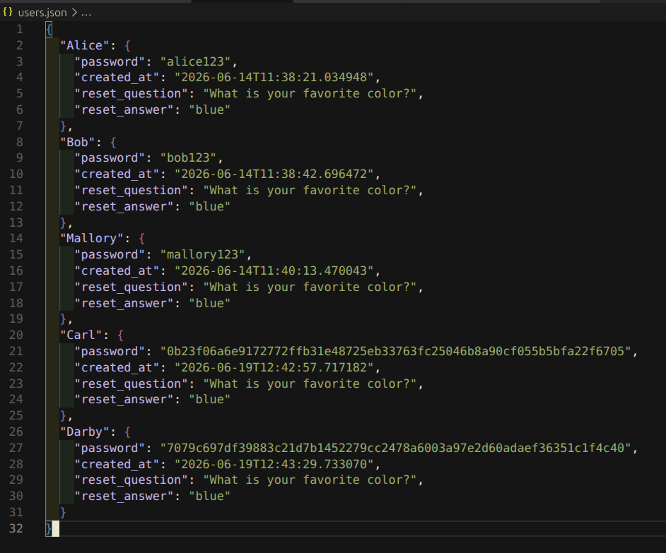

After:

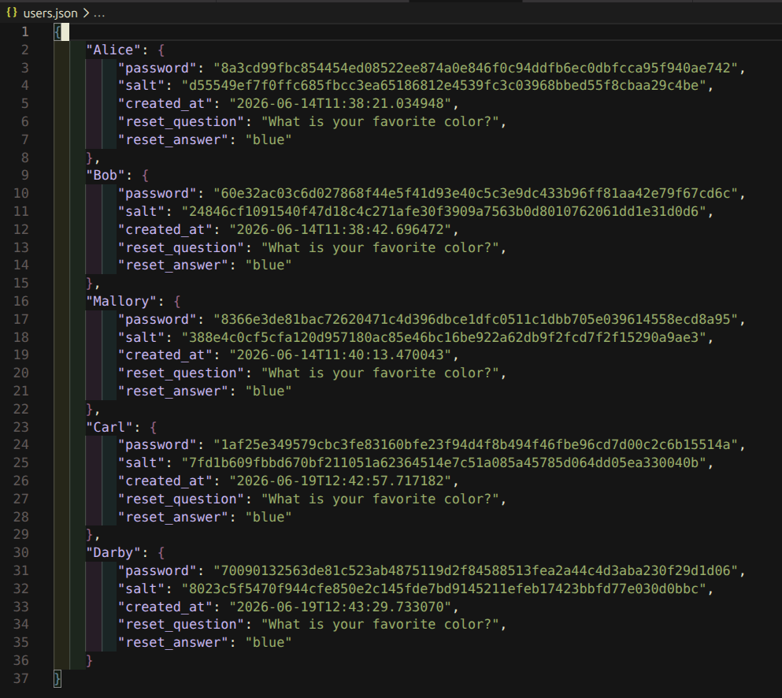
---

### Attack 2: Eavesdropping Attack

#### Objective
<!-- What vulnerability does this attack exploit? -->
Demonstrate that the base application transmits credentials and message content as plaintext over TCP, allowing a passive network attacker to read all traffic without any decryption.

#### Attack Setup
<!-- Describe your attack setup and tools used -->

**Tools Used**:
- Tool 1: Wireshark: Packet capture and inspection on the loopback interface
- Tool 2: SecureText application: Two client terminals and one server terminal running locally

#### Attack Execution
<!-- Step-by-step description of the attack -->

Step 1: Open Wireshark, select the lo loopback interface and set capture filter tcp port 12345

Step 2: Start the SecureText server and log in as Alice and Bob in separate terminals

Step 3: Send a message between users, then stop capture and follow the TCP stream to read the plaintext JSON

See: capture_evidence/task3.1.a_conversation.pcapng

#### Results and Evidence
<!-- Show evidence of successful attack, for example: -->
Application communication:
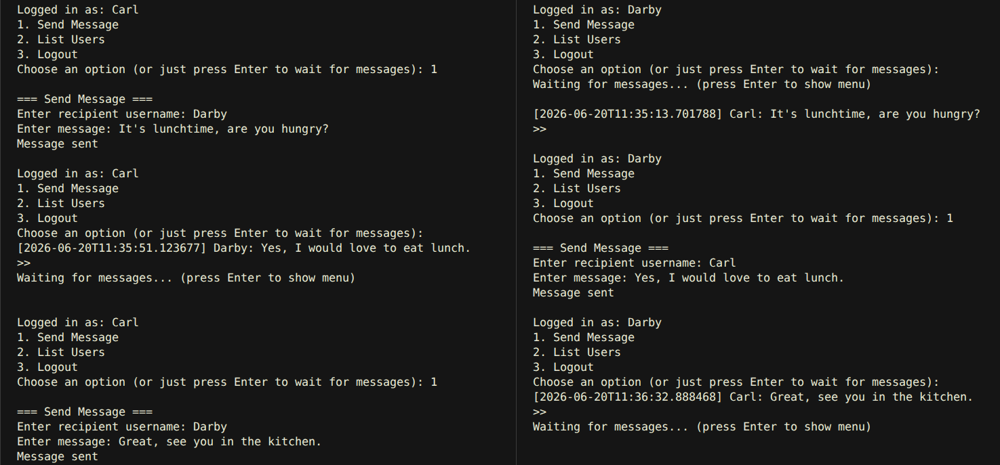
Eavesdropping using Wireshark, filtered as tcp.port ==12345:
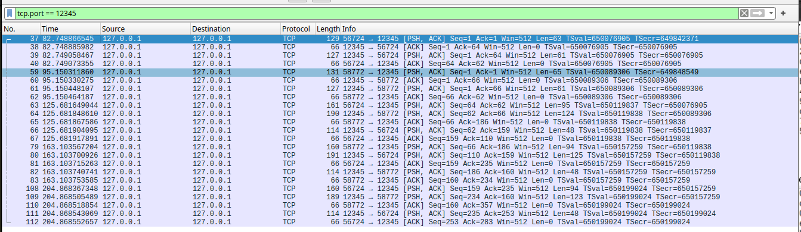
Message sent over TCP in plaintext “It’s lunchtime, are you hungry?”:
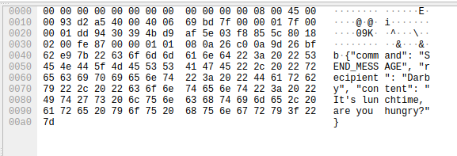

```
Attack Output:

(See images above)
```

#### Mitigation
<!-- How did you fix this vulnerability? -->

- The application has no transport encryption. The correct mitigation is TLS, which would encrypt all traffic on the wire and make the captured packets unreadable to a passive attacker. This was not implemented in this assignment and remains an open vulnerability.
---


### Attack 3: Length Extension Attack

#### Objective
<!-- What vulnerability does this attack exploit? -->
Exploit the flawed MAC construction SHA-256(k||m) to forge a valid MAC for an extended message without knowledge of the secret key, demonstrating that Merkle-Damgard based MACs are vulnerable to message extension by a man-in-the-middle attacker.

#### Attack Setup
<!-- Describe your attack setup and tools used -->

**Tools Used**:
- Tool 1: Wireshark - Capture a legitimate SEND_MESSAGE packet to obtain the original message and MAC.
- Tool 2: attack_length_extension.py: Man-in-the-middle proxy that intercepts and forges messages in real time.
- Tool 3: iptables: Redirect client traffic through the proxy transparently, simulating MITM.

#### Attack Execution
<!-- Step-by-step description of the attack -->

Step 1: Start the server, proxy, and iptables redirect, then log in as Alice and Bob.


Step 2: Alice sends CMD=SET_QUOTA&USER=bob&LIMIT=100 to Bob — the proxy intercepts the message and extracts the MAC.
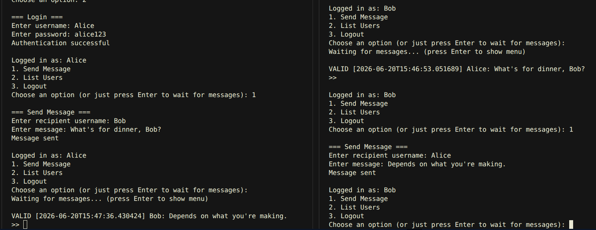

Step 3: The proxy uses the captured MAC to forge a valid MAC for CMD=SET_QUOTA&USER=bob&LIMIT=100||padding||&CMD=GRANT_ADMIN&USER=attacker and forwards it to the server, which accepts it as authentic
(shown in next section).
#### Results and Evidence
<!-- Show evidence of successful attack, for example: -->
Wireshark capture showing message and MAC:
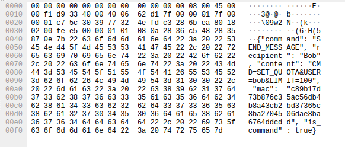
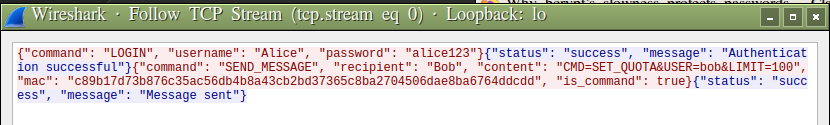

Attack successful:


#### Mitigation

The flawed MAC was replaced with HMAC-SHA256 in securetext_secure_mac.py. 

```python
def compute_mac(key, message):
    return hmac.new(key, message.encode('latin-1'), hashlib.sha256).hexdigest()

def verify_mac(key, message, mac):
    expected = compute_mac(key, message)
    result = hmac.compare_digest(expected, mac)
```

HMAC uses a nested hash construction that prevents an attacker from resuming the internal hash state, making length extension impossible. Running the same proxy attack against the secure server show that verification failed, with the expected and recieved MAC mismatched:

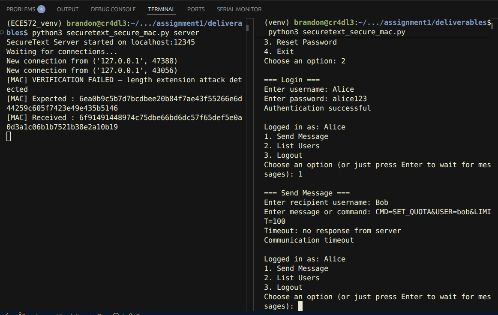

Above right, Alice has sent the command the same way using the insecure mac, but below left, Bob doesn’t recieve the forged message even though it was picked up by our length extension attack script, below right.

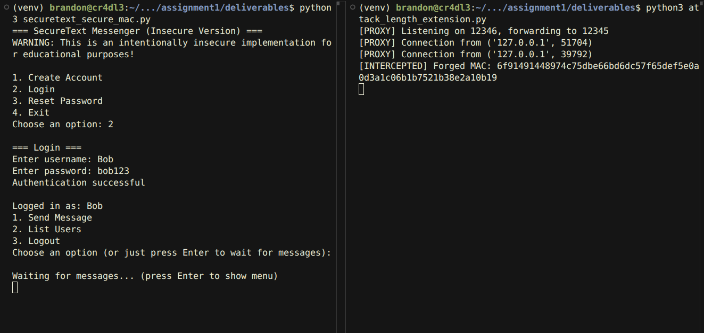
---

## 5. Performance Evaluation
Basic test results in terms of resources used in terms of hardware and time. Also, if the test has limitations and fix worked properly(test passed or failed)

**Measurement Setup**:
- Test Environment: Linux Lubuntu, Python 3.12.3, single machine with no load

**Note**: 
Performance measurements for hashing speed, dictionary attack timing, and theoretical brute force times are already documented with full results in Task 2 - Testing and Validation. Attack success and failure outcomes are documented previously in Section 4 - Attack Demonstrations.

---

## 6. Lessons Learned

### Technical Insights
<!-- What did you learn about security implementations? -->

- **Insight 1**: Hashing algorithm choice has compounding consequences: SHA-256 is a fast, general-purpose hash appropriate for data integrity but not passwords.
- **Insight 2**: HMAC verifies a message wasn't tampered with, but it can still be read without proprer transport encryption.
- **Insight 3**: Plain text is bad. Don't store plain text, don't send plain text. B-A-D.

### Security Principles
<!-- How do your implementations relate to fundamental security principles? -->

**Applied Principles**:
- **Defense in Depth**: Password security was addressed at two layers, hashing at rest and salt protection against precomputed attacks. 
- **Least Privilege**: Not directly applied in this assignment; the hardcoded shared key and single trust level for all users is a noted remaining gap.
- **Fail Secure**: MAC verification rejects messages on failure rather than passing them through, and the secure implementation logs the mismatch explicitly.
- **Economy of Mechanism**: Both MAC implementations reuse existing Python standard library primitives (hashlib and hmac) rather than introducing custom cryptographic code.

---

## 7. Conclusion

### Summary of Achievements
<!-- Summarize what you accomplished -->
The base SecureText application was analysed, seven vulnerabilities were identified in total, and two were addressed within the scope of this assignment. Password storage was hardened by replacing plaintext storage with PBKDF2-SHA256 at 600,000 iterations with unique per-user salts, and an in-place migration script was written to transition the existing database. Message authentication was implemented in two stages: a deliberately flawed SHA-256(k||m) MAC to demonstrate the length extension vulnerability, and a secure HMAC-SHA256 replacement that defeats it. Both the attack and the fix were demonstrated end-to-end using a man-in-the-middle proxy.

### Security and Privacy Posture Assessment
<!-- How secure is your final implementation? -->
The final implementation is significantly more secure than the base application with respect to password storage and message integrity, but remains vulnerable at the network layer. There remains an interesting attack chain:
1. attacker chooses "Reset Password" from command menu for a known user.
2. logs in with comprimised account and chooses "List Users" from command menu.
3. repeats step 1 for any (or all) listed users.
This results in a large platform compromise.

**Remaining Vulnerabilities**:
- Vulnerability 1: No transport encryption - All traffic including credentials and message content is transmitted as plaintext over TCP. PBKDF2 and HMAC protect stored data and message integrity but do nothing for confidentiality in transit.
- Vulnerability 2: Non-autthorised password resets.
- Vulnerability 3: User enumeration.

**Suggest an Attack**: In two lines mention a possible existing attack to your current version in abstract
- Vulnerability 1: A passive attacker sniffing the loopback interface can capture login credentials in plaintext and replay them to authenticate as any user, bypassing all password and MAC protections entirely. Which we found earlier:
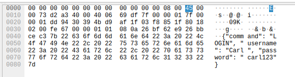
- Vulnerability 2&3: detailed above in Security and Privacy Posture Assessment.

### Future Improvements
<!-- What would you do if you had more time? -->

**Improvement 1**: Implement TLS to encrypt all traffic in transit, eliminating plaintext credential and message exposure.
**Improvement 2**: Replace the hardcoded pre-shared key with per-session keys derived from a master secret using a key derivation function, loaded from a secrets manager rather than source code.

---

## 8. References

<!-- 
Include all sources you referenced, including:
- Course materials and lecture notes
- RFCs and standards
- Academic papers
- Documentation and libraries used
- Tools and software references
-->
[1] B. P. C, “How to Perform Secure Hashing Using Python's hashlib Module,” freeCodeCamp.org, Jan. 22, 2026. https://www.freecodecamp.org/news/how-to-perform-secure-hashing-using-pythons-hashlib-module/

[2] “PBKDF2 | Practical Cryptography for Developers,” Practical Cryptography for Developers. https://cryptobook.nakov.com/mac-and-key-derivation/pbkdf2

[3] S. Josefsson, “PKCS #5: Password-Based Key Derivation Function 2 (PBKDF2) Test Vectors,” Jan. 2011. doi: 10.17487/rfc6070.

[4] “Password Storage - OWASP Cheat Sheet Series.” https://cheatsheetseries.owasp.org/cheatsheets/Password_Storage_Cheat_Sheet.html

[5] Salvatoreadduci, “length-extension-attack/Length Extension Attacks.pdf at main · salvatoreadduci/length-extension-attack,” GitHub. https://github.com/salvatoreadduci/length-extension-attack/blob/main/Length%20Extension%20Attacks.pdf

[6] “Hash length extension attack example - crypto-condor 2025.02.07 documentation.” https://quarkslab.github.io/crypto-condor/2025.02.07/method/sha/hash_length_extension.html

[7] Computerphile, “Coding a SHA2 length extension attack - Computerphile,” YouTube. Sep. 25, 2025. [Online]. Available: https://www.youtube.com/watch?v=XQo6rLdFlCg

---

## Submission Checklist

Before submitting, ensure you have:

1. **Complete Report**: All sections filled out with sufficient detail
2. **Evidence**: Screenshots, logs, and demonstrations included
3. **Code**: Well-named(based on task and whether it is an attack or a fix) and well-commented and organized in your GitHub repository deliverable directory of the corresponding assignment
4. **Tests**: Security and functionality tests implemented after fix
5. **GitHub Link**: Repository link included in report and Brightspace submission
6. **Academic Integrity**: All sources properly cited, work is your own
7. **AI Disclosure**: `GENAI.md` included in deliverables, disclosing any AI use

---

**Submission Instructions**:
1. Save this report as PDF: `[StudentID]_Assignment[X]_Report.pdf`
2. Submit PDF to Brightspace
3. Include your private GitHub repository link in the Brightspace submission comments
4. Ensure your repository is private until after course completion otherwise you'll get zero grade

**Final Notes**:
- Disclose AI use in a `GENAI.md` file in your deliverables (prompts used, which files AI touched). See the Academic Integrity section of the root README.
- Be ready to explain any code you submit. If you can't explain it, don't submit it.
- Be honest about limitations and challenges
- Focus on demonstrating understanding, not just working code
- Proofread for clarity and technical accuracy

Good luck!
